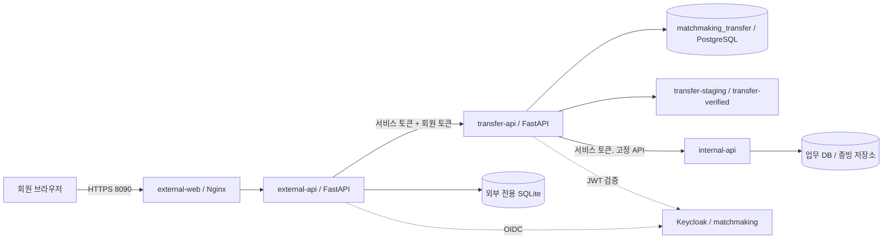

# 아키텍처

- 공통 Compose의 external-net, delivery-net, transfer-net, transfer-db-net을 유지합니다. overlay는 빌드 컨텍스트와 외부 전용 세션 볼륨·키만 추가합니다.
- 외부 API는 업무 DB·반출 DB·파일 볼륨·증빙 원본을 직접 열 수 없습니다. 증빙 제출은 중계를 통해 내부의 고정 API로 전달합니다.
- 파일 저장소는 웹 정적 경로로 공개하지 않습니다. 파일 경로 대신 UUID만 사용하며 DB 저장 키도 UUID와 일치해야 합니다.
- 소개 자료는 고정 JSON 스키마를 검사합니다. 전체 회원 CSV 등은 대기영역에 차단 상태로 등록되며 정상 승인 대상이 아닙니다. 이 검사는 백신·일반 DLP 제품의 대체가 아닙니다.
- 승인 시 파일 ID·버전·SHA-256, 수신자·동의·목적·만료를 고정합니다. 다운로드 시 승인 조건과 실제 바이트 해시를 재확인합니다.
- baseline은 승인 파일의 적합성을 먼저 확인한 후 요청 파일 선택의 결함만 재현합니다. enforce는 다른 파일 지정을 반환 전에 거부합니다.
- 감사 기록은 JSON 파일과 중계 DB에 저장합니다. Wazuh 배포·수집·경보 규칙은 별도 관제 통합 범위입니다.
- 호스트 한 대의 Docker 논리망 구성입니다. 물리 폐쇄망 또는 노트북 두 대 간 통신 구성을 완료했다는 의미가 아닙니다.
